# Audi B9 MHI2Q CarPlay Maps In VC & Firmware Update Guide

A community writeup for installing the open-source CarPlay Maps in VC patch on **B9 generation** Audi vehicles equipped with MHI2Q head units. 

This implementation is based on the open-source project by **Luka_Dev**: [mib2q-carplay-rgi](https://github.com/luka-dev/mib2q-carplay-rgi).

---

## Prerequisites & Warnings

* Please read everything and understand the risks before proceeding.
* **Target Vehicles:** B9 generation Audi models (A4, S4, A5, S5, Q5, etc.) with MHI2Q infotainment systems.
* **Firmware Version:** You should be updated to the latest version for your region. My car is a North American S5 on **MU1316**.
  * You can find your latest supported firmware using [MIB Helper](https://mib-helper.com).
* **Firmware Source:** Firmware can be downloaded from [MIB Solution](https://mibsolution.one/) or [mib.plain.gg](https://mib.plain.gg/).
* **Do Not Mix Firmware Versions:** If your current version is `MHI2_US_AUG22_XXXXX`, you can only update/patch using compatible matching firmware tracks. Don't pay for updates—they are free online.
* Ensure SD card is formatted to FAT32.

---

## Step 1: Check Current Firmware Version

You can find your vehicle's firmware version by using specific button combinations on your center console to enter the **RED (Red Engineering Menu)**. *(Note: These button combinations also work to enter the GEM).*

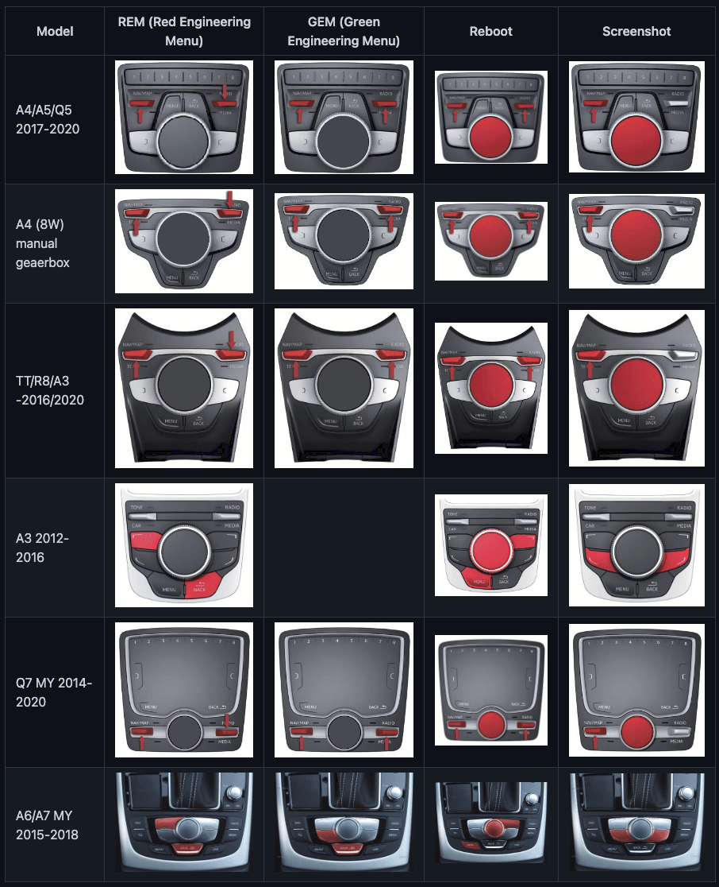

---

## Step 2: Installing Firmware Updates

1. Copy all extracted files from the firmware update directly onto the root of an SD card.
2. Insert the SD card into **Slot 1** of your vehicle.

**Example File Structures:**

  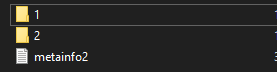
   
  <strong>OR</strong>
    
  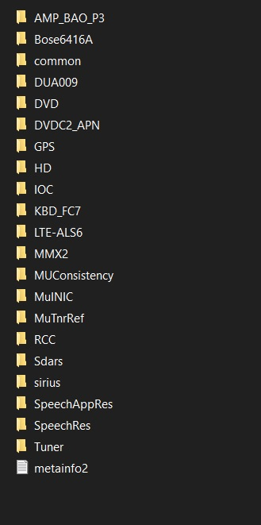

 

3. Enter into the **REM** and follow the on-screen prompts:

  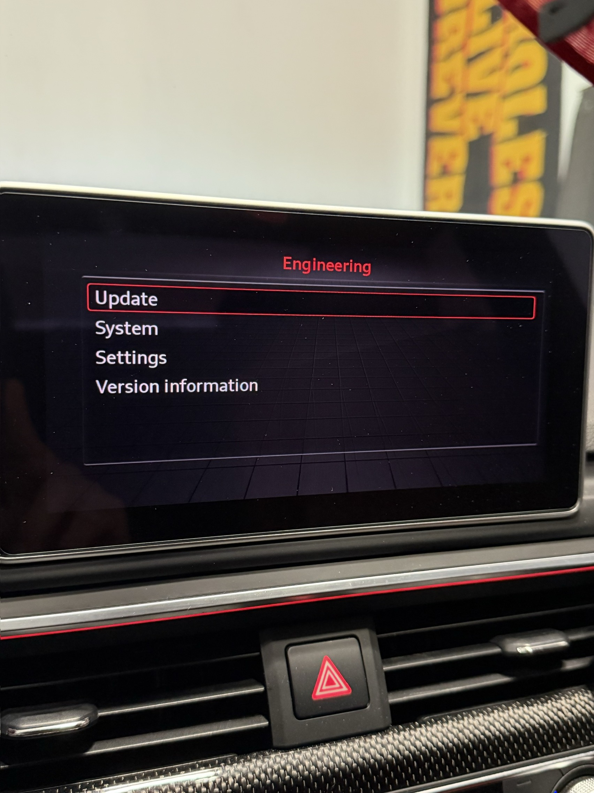
  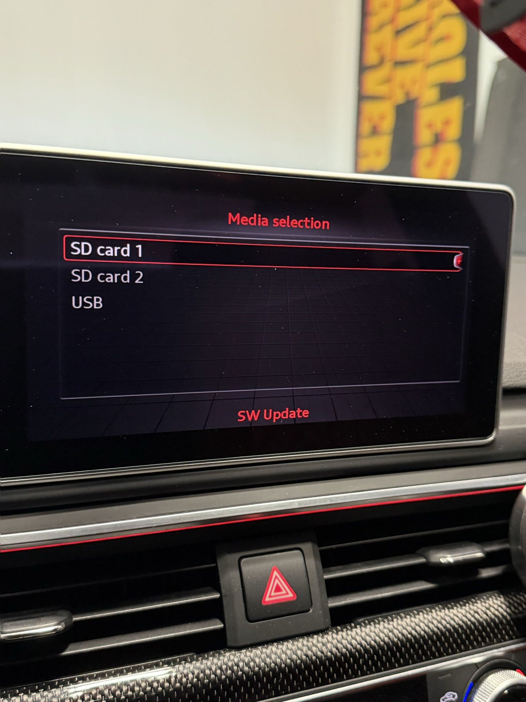
  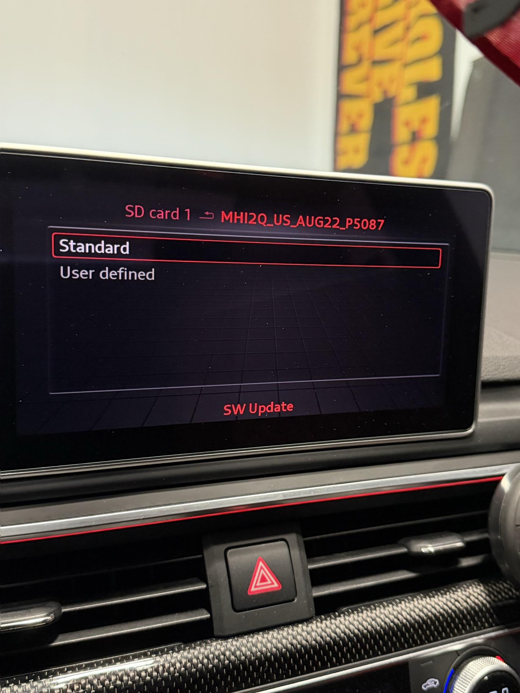

  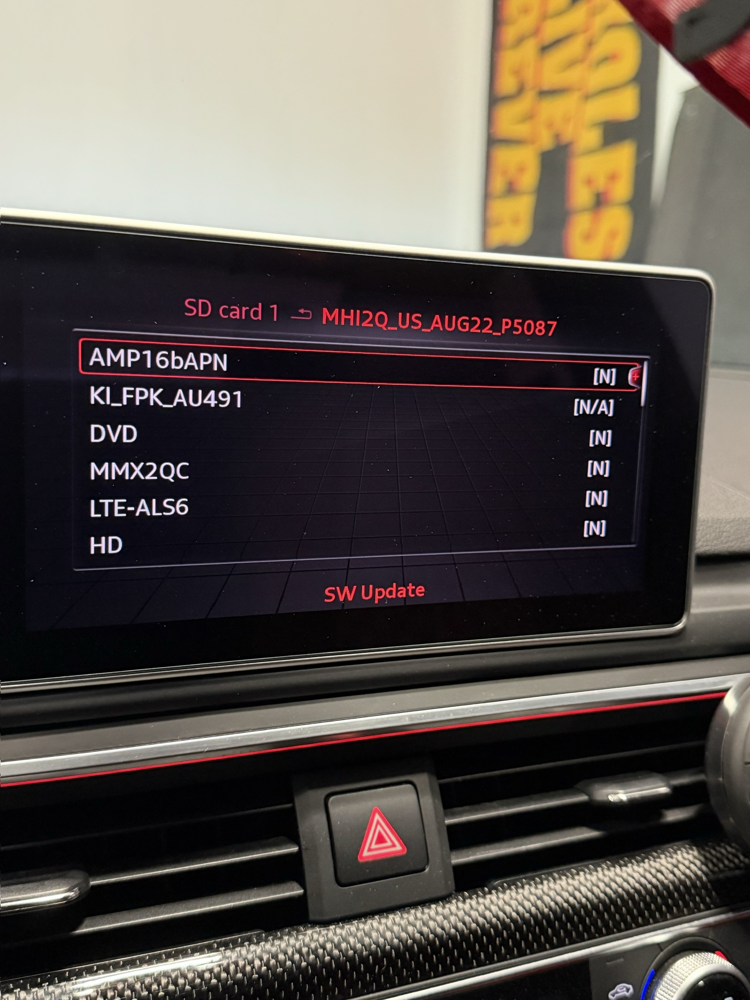
  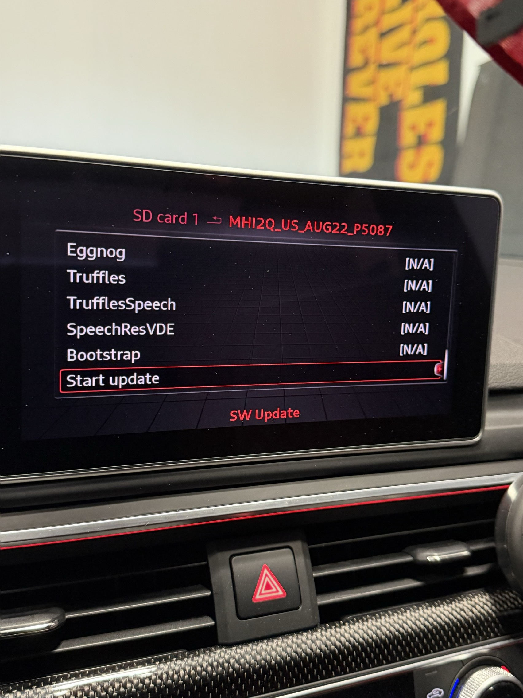

*(Note: Beside the amplifier entry, it will show an "N" for models equipped with Bang & Olufsen sound systems. If it shows a Y, you will need to disable the amplifier update.).*

4. Start the update and let it run. The screen may occasionally go black—**let it do its thing**. It usually takes around 20 minutes.
5. When the car prompts you for a log update, select **Cancel**, and it will perform a final reboot.

---

## Step 3: Installing More Incredible Bash (M.I.B.)

Next, you will need to install the **More Incredible Bash (M.I.B.) toolbox**: 
[Mr-MIBonk/M.I.B._More-Incredible-Bash](https://github.com/Mr-MIBonk/M.I.B._More-Incredible-Bash)

1. Installation is identical to the firmware update. Copy all files from the M.I.B. GitHub repository to the root of your SD card. *(Make sure to remove old firmware files or use a separate, freshly formatted FAT32 SD card).*
2. Reinsert the SD card into **Slot 1** and repeat the REM steps. 
3. Installing the M.I.B. Toolbox will also unlock and enable the **GEM (Green Engineering Menu)**.

---

## Step 4: Installing Luka_Dev’s CarPlay Solution

1. Download the latest release package from [Luka_Dev's mib2q-carplay-rgi repository](https://github.com/luka-dev/mib2q-carplay-rgi).
2. Copy all files from the download directly onto the root of your SD card that **already contains the M.I.B. Toolbox files**.
3. When your computer asks if you would like to overwrite or replace existing files, click **YES**.
4. Insert the SD card back into **Slot 1**.
5. Boot into the **GEM**, navigate through the M.I.B. menus as shown below:

  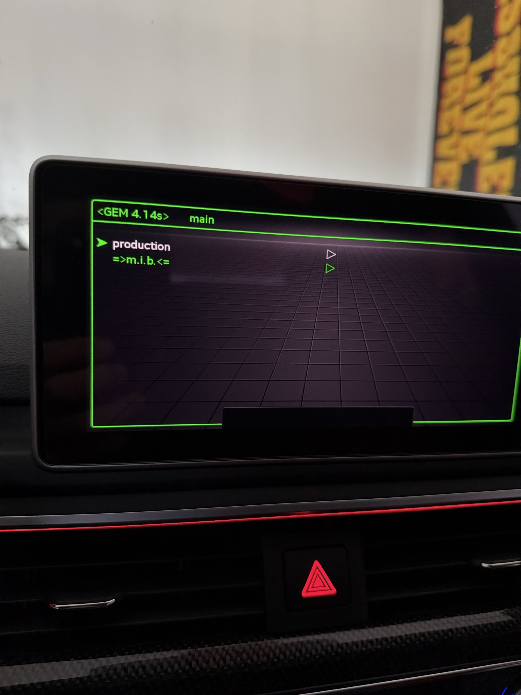
  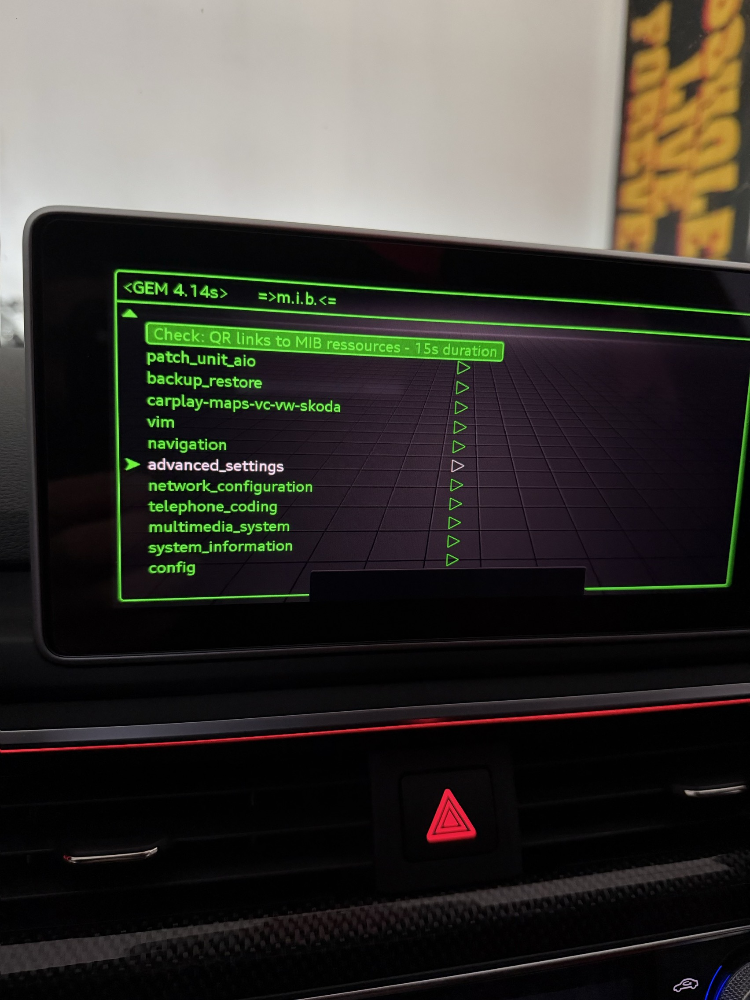

6. Scroll all the way down to find **Run Custom Script**:

  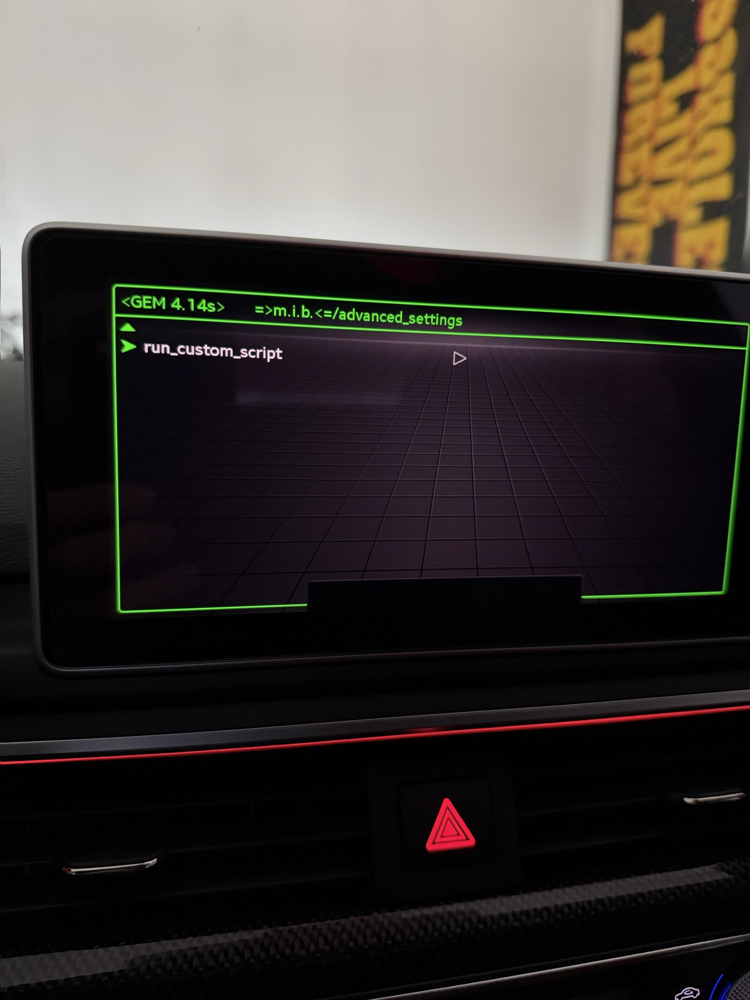
  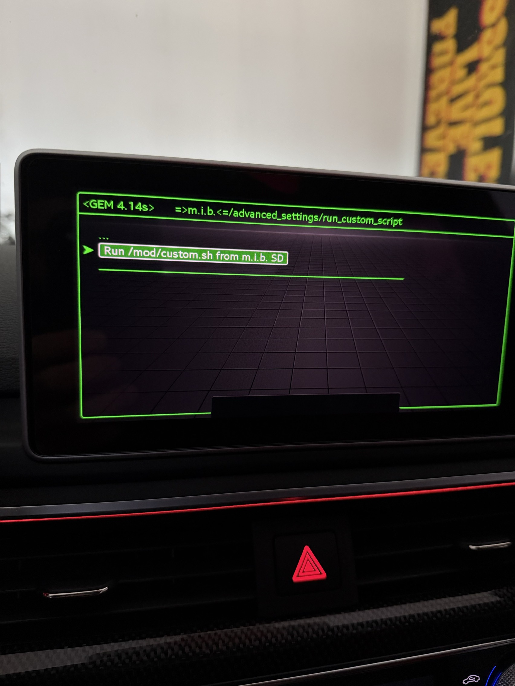
  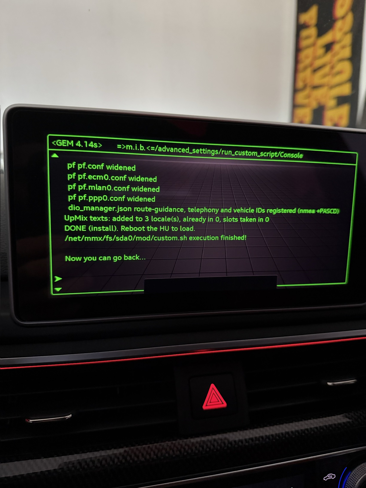

7. Wait 30 seconds after the M.I.B. toolbox says *"now you can go back"*, then manually restart your head unit.

---

## Troubleshooting & Post-Install Notes

### Clearing 5F Fault Codes
Sometimes after updating the firmware, scanning your vehicle with OBD11, VCDS, or a similar diagnostic tool will show fault codes in module `5F - Information Electr.`. 

These error codes (such as "Check Software Version Management") are standard after manual firmware updates and can easily be cleared by recalculating/updating the value. Follow the step-by-step instructions here: [MIB Helper - SVM XOR Calculator](https://mib-helper.com/im-so-xory/).

---

## Finished!

Once your unit reboots, connect your phone via wire for CarPlay. The solution will initialize automatically and run right away.

## To Uninstall
To uninstall, repeat the same installation steps but use the uninstall zip files from the repo.

*Disclaimer: Please direct any specific compatibility questions to the repository developers rather than posting general inquiries here.*
